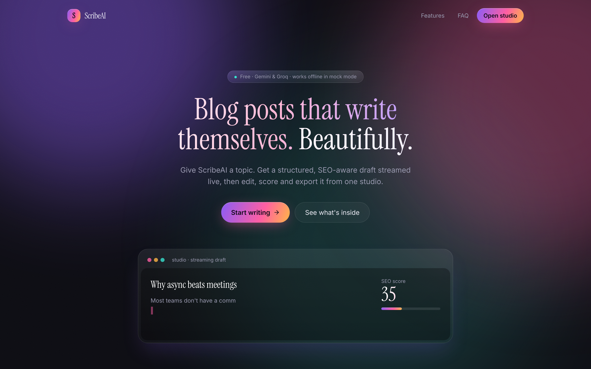
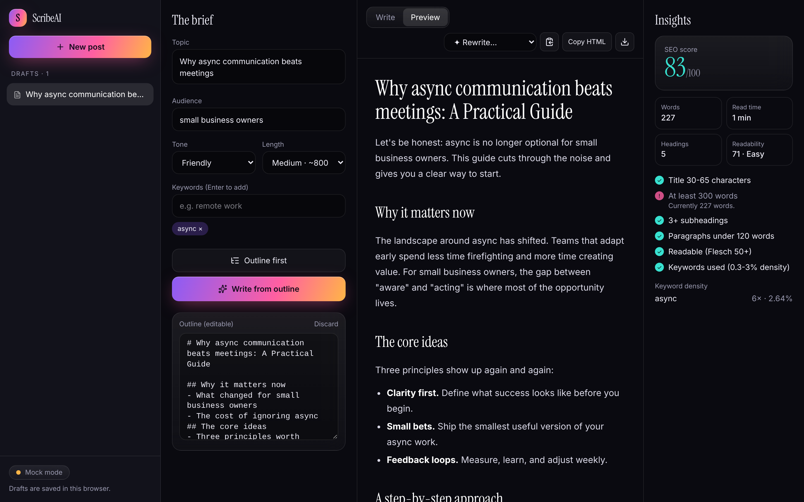
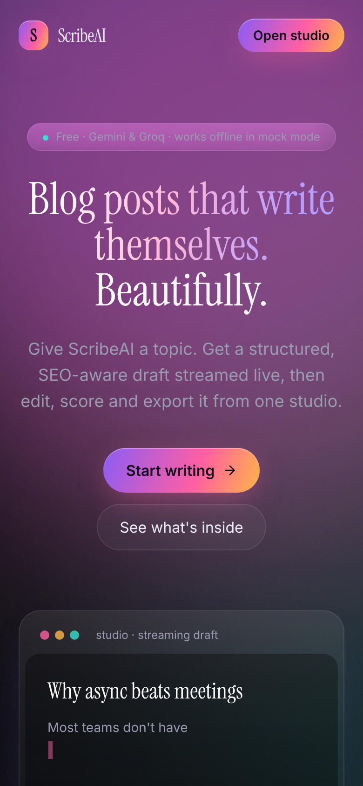
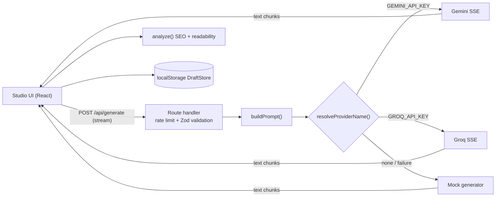

# ScribeAI

**Turn a topic into an SEO-aware blog post: streamed live, editable, scored and exportable, from one beautiful studio. Runs with free Gemini/Groq keys, or with no keys at all.**



| Studio (outline → draft → score) | Mobile |
| --- | --- |
|  |  |

## Features

- **Streaming generation**: the post appears token by token; stop at any time.
- **Outline-first workflow**: generate and edit an outline, then write the post from it.
- **Live SEO insights**: score out of 100, title length, keyword density, Flesch readability, heading count, reading time.
- **One-click rewrites**: shorter, expand, simplify, punchier intro.
- **Markdown editor + live preview**, autosaved drafts (browser storage), multiple drafts.
- **Export**: copy Markdown or HTML, download `.md`.
- **Provider abstraction** (Gemini, Groq, mock) with automatic fallback to mock if a call fails.
- Loading skeletons, empty states, error banners, rate limiting, responsive layout, reduced-motion support.

## Tech stack

Next.js 15 (App Router) · TypeScript (strict) · Tailwind CSS 4 · Zod · react-markdown · Vitest · ESLint · GitHub Actions.

## Architecture



## Getting started

```bash
npm install
cp .env.example .env.local   # optional: add GEMINI_API_KEY or GROQ_API_KEY
npm run dev                   # http://localhost:3000
```

Other scripts: `npm test`, `npm run lint`, `npm run typecheck`, `npm run build`.

See [developer.md](developer.md) for the audit, env vars, deployment and decisions, and [CHANGES.md](CHANGES.md) for a feature-by-feature walkthrough.

## Roadmap

- Accounts + cloud sync (a `DraftStore` implementation backed by a free-tier DB)
- Image suggestions and cover generation
- Brand-voice profiles; publish to WordPress/Ghost/Dev.to
- Per-section regenerate and diff view for rewrites
